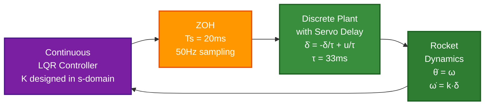
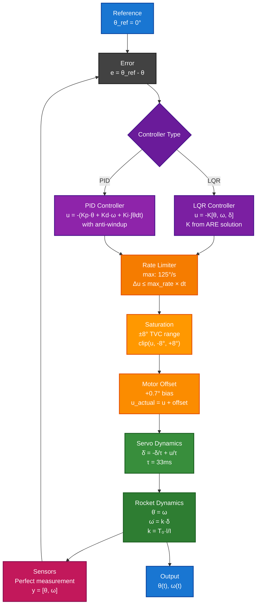

# LQR Rocket Control System

Optimal Linear Quadratic Regulator (LQR) implementation for single-axis rocket attitude control with realistic servo modeling and PID comparison.

## Installation
```bash
pip install numpy scipy matplotlib
```

## System Architecture

### Discretization Method: Option 3 - Continuous Controller + ZOH + Continuous Plant

The system uses **continuous-time controller design** with **Zero-Order Hold (ZOH) discretization**:

1. **Servo delay** is modeled as a first-order lag in the continuous domain: `δ̇ = -δ/τ + u/τ` (τ = 33ms)
2. **Continuous plant** includes rocket dynamics + servo dynamics as a 3-state system
3. **ZOH discretization** converts the continuous plant to discrete at 50Hz sampling rate
4. **Continuous LQR controller** is designed using the continuous plant, then applied to the discrete system

This approach allows linear controller design in the s-domain while properly accounting for the discrete MCU implementation and servo delays.



### Detailed System Block Diagram

The control system is implemented as modular building blocks, each corresponding to physical components and config parameters:



**Block Color Legend:**
- 🔵 **Blue**: Reference/Output blocks
- ⚫ **Gray**: Error calculation
- 🟣 **Purple**: Controller blocks (LQR/PID)
- 🟠 **Orange**: Actuator constraint blocks
- 🟢 **Green**: Physical dynamics blocks
- 🔴 **Pink**: Sensor blocks

## Usage
```bash
python main.py config.json
```

### Arguments
- `config`: Path to JSON configuration file (required)
- `--T`: Simulation time in seconds (overrides config, optional)
- `--angle`: Initial angle disturbance in degrees (overrides config, optional)
- `--thrust`: Constant thrust in Newtons, default: `3.5`

### Examples
```bash
# Use all config defaults (6s simulation, 20° initial angle, 3.5N thrust)
python main.py config.json

# Override simulation time
python main.py config.json --T 10

# Override initial angle (in degrees)
python main.py config.json --angle 15

# Override thrust level
python main.py config.json --thrust 4.0

# Combine overrides
python main.py config.json --T 8 --angle 25 --thrust 3.0
```

## Configuration

The system uses comprehensive defaults from `config.json`. All relevant parameters are automatically loaded:

### Physical Parameters (from config)
```json
{
    "mass": 0.292,                    // Rocket mass (kg)
    "moment_of_inertia": 0.00469,     // Moment of inertia (kg⋅m²)
    "tvc_to_COM": 0.147,              // TVC to center of mass distance (m)
    "constant_thrust_N": 3.5          // Thrust force (N)
}
```

### Simulation Parameters (from config)
```json
{
    "sim_time_seconds": 6,            // Total simulation time
    "initial_x_rot_angle": 20,        // Initial rocket tilt (degrees)
    "servo_frequency_hz": 50,         // Control frequency (Hz)
    "servo_delay_sec": 0.03333        // Actuator delay (seconds)
}
```

### Servo Constraints (from config)
```json
{
    "tvc_angle_range": 8.0,           // Max TVC deflection (±degrees)
    "tvc_deg_per_second_max": 125.0,  // Max servo rate (deg/s)
    "tvc_linkage_ratio": 4,           // Servo:TVC ratio (4:1)
    "tvc_motor_offset_x_deg": 0.7     // Calibration error (degrees)
}
```

### Control Parameters (from config)
```json
{
    "STAB_KP": 0.15,                  // PID proportional gain
    "STAB_KD": 0.055,                 // PID derivative gain
    "STAB_KI": 0.08                   // PID integral gain
}
```

## System Model

**Single-Axis Control**: States `[θ, ω, δ]` (angle, angular velocity, TVC deflection)

The system includes realistic servo modeling:
- **Linkage ratio**: 4:1 servo-to-TVC movement
- **Angle limits**: ±8° TVC deflection range
- **Rate limits**: 125°/s maximum servo speed
- **Motor offset**: 0.7° calibration error for integrator testing
- **Servo delay**: 33ms actuator time constant

## Features

### Realistic Servo Modeling
- Physical servo constraints and limitations
- Linkage ratio effects (servo moves 4x more than TVC)
- Motor calibration offset for testing integrator response
- Rate and angle limiting

### Enhanced Visualization
- **Dual plots**: Angle response and control signals
- **System limits**: Shows TVC angle constraints
- **Reference lines**: Target angle and physical limits
- **Clear formatting**: Professional plots with proper scaling

### Comprehensive Output
- **System parameters**: Displays all loaded configuration
- **Controller gains**: Shows both LQR and PID gains
- **Performance metrics**: Final angle values for comparison
- **Real-time info**: Simulation progress and results

## LQR Tuning

The LQR controller is designed automatically. For custom tuning, modify Q and R matrices:

```python
# In design_lqr function call:
Q = np.diag([10, 1, 0.1])  # [angle, rate, deflection] weighting
R = np.array([[1]])        # Control effort weighting
K_lqr = design_lqr(sys_c.A, sys_c.B, Q, R)
```

**Tuning guidelines:**
- **Faster response**: Increase Q[0,0] (angle weighting)
- **More damping**: Increase Q[1,1] (rate weighting)  
- **Less control effort**: Increase R value
- **Tighter control**: Decrease R value

## Sample Output

```
=== Rocket System Parameters ===
Mass: 0.292 kg
Moment of Inertia: 0.00469 kg⋅m²
TVC to COM: 0.147 m
Constant Thrust: 3.5 N
Servo Frequency: 50 Hz
Servo Delay: 0.03333 s
TVC Angle Range: ±8.0°
Max Servo Rate: 125.0°/s
Linkage Ratio: 4:1
Motor Offset: 0.7°
Initial Angle: 20°
Simulation Time: 6 s

=== Controller Gains ===
LQR Gains: K = [1.0, 1.03, 2.08]
PID Gains: Kp=0.15, Kd=0.055, Ki=0.08

=== Running Simulations ===
Final angle - LQR: 0.75°, PID: 4.67°
```

## Comparison with Full Simulator

This script is designed to match your full simulator setup:
- **Same thrust**: 3.5N constant thrust
- **Same constraints**: Realistic servo limitations
- **Same parameters**: All physical parameters from config
- **Same frequency**: 50Hz control loop
- **Same offset**: 0.7° motor calibration error

Perfect for validating control algorithms before full simulation testing.

## Troubleshooting

- **No plots showing**: Check matplotlib backend, plots should display automatically
- **Config errors**: Validate JSON syntax and file path
- **Unstable response**: Check thrust value and controller gains
- **Wrong initial angle**: Verify `initial_x_rot_angle` in config (degrees)
- **Servo limits**: Check if TVC commands exceed ±8° range

## Theory

For detailed understanding of the state-space construction, building block analysis, and LQR theory, see `Theory.md`.

## Notes

- **Angle units**: Config uses degrees, command line uses degrees, plots show degrees
- **Servo modeling**: Includes realistic constraints for hardware validation
- **Motor offset**: 0.7° offset tests integrator wind-up handling
- **Frequency**: Simulation runs at servo frequency (50Hz) for accuracy
- **Comparison ready**: Output format matches full simulator for easy validation 